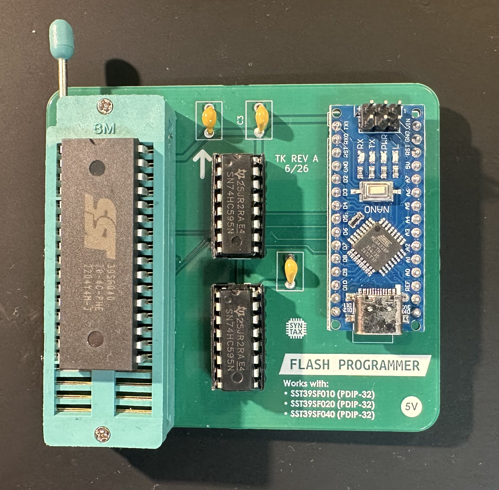

# EEPROM/flash programmer

Ardunio Nano based SST39SF0x0 programmer (so technically flash and not an EEPROM).

Requires two 74x595 (8-bit shift registers; I used 74HC595) as well as three 100nF capacitors (ceramic THT).
For inserting the flash IC, I recommend a ZIF socket (as seen in the image below).

The PCB was designed in KiCAD and manufactured by JLCPCB.

`eeprom_prog.ino` is the firmware for the Arduino Nano and can be compiled and programmed using the Arduino IDE.

`make build` builds the binary (`eeprom_prog.cpp`) for communicating with the Arduino Nano (Linux-only).

use `./eeprom_prog.out read /dev/<DEVICE> <output file path>` to read from the flash
and `./eeprom_prog.out write /dev/<DEVICE> <input file path>` to write to the flash.

I recommend reading again after writing and verifying that the write was actually successful.
